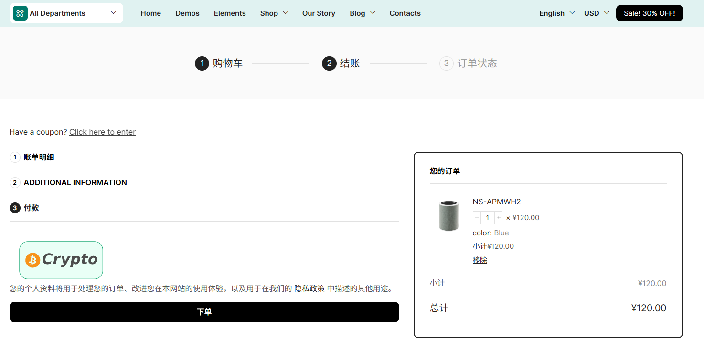
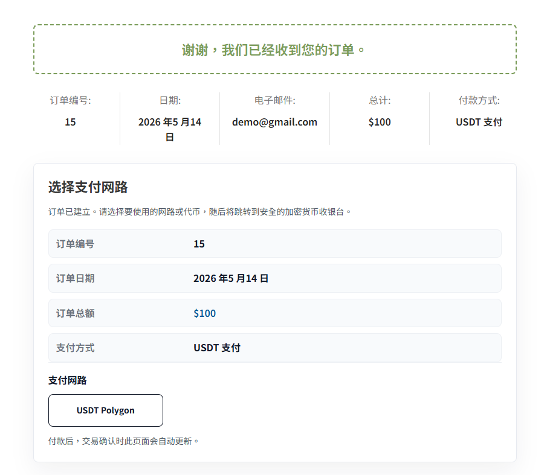
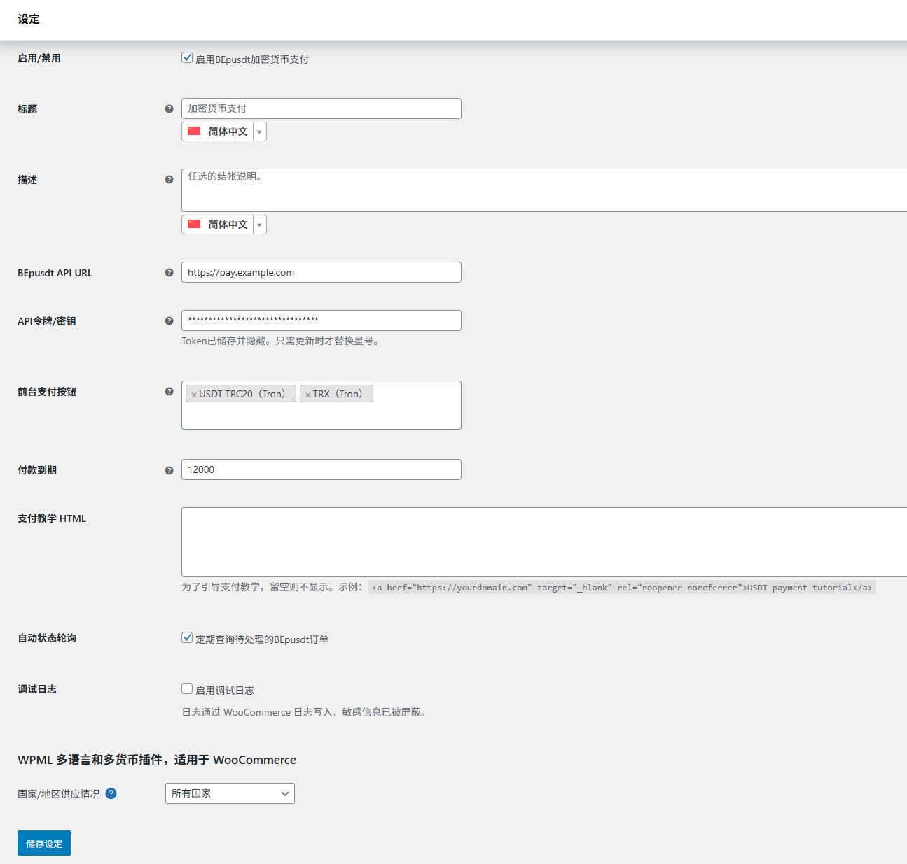

# BEpusdt for WooCommerce


### 前台支付方式显示



### 结账页



插件当前版本：`1.5.0`

BEpusdt for WooCommerce 是一个 WordPress + WooCommerce 加密货币收款插件，用于把 WooCommerce 订单接入 BEpusdt 后端收银台。插件负责在 WooCommerce 中注册支付网关、创建 BEpusdt 支付交易、展示前端支付入口，并通过 BEpusdt 回调或 WordPress Cron 轮询同步订单支付状态。

## BEpusdt 是什么

BEpusdt 是一个开源的个人加密货币收款网关：

```text
https://github.com/v03413/BEpusdt
```

BEpusdt 后端支持多条区块链网络和多种代币收款。实际可用的网络、币种和钱包地址以你部署的 BEpusdt 后端配置为准。本插件不会替代 BEpusdt 后端，只负责把 WordPress + WooCommerce 商城订单连接到 BEpusdt 收银台。

## 主要功能

- 在 WooCommerce 后台注册 `BEpusdt Crypto` 支付网关。
- 同时支持经典结账页和 WooCommerce Checkout Block。
- 使用 WooCommerce CRUD API，并声明 HPOS 兼容。
- 结账页保持 WooCommerce 默认流程，只显示一个轻量的加密货币视觉支付入口。
- 结账页可选显示自定义支付教程 HTML，例如 USDT 支付教程链接。
- 用户提交订单后进入 WooCommerce Thank You 页面。
- Thank You 页面显示订单信息和后台启用的加密货币支付按钮。
- 用户点击某个链或代币按钮后，插件向 BEpusdt 创建支付交易。
- 创建成功后跳转到 BEpusdt 收银台完成付款。
- 支持 BEpusdt 回调和 WordPress Cron 轮询同步 WooCommerce 订单状态。
- 支持从 GitHub 正式 Release 检查并安装后续版本更新。
- BEpusdt 返回错误时，错误会显示回 Thank You 页面支付卡片，不让 WordPress 产生致命错误。

公共版已移除除 USDT 以外的其他视觉化支付入口及其前后端代码。

## 目录结构

```text
bepusdt-woocommerce/
  assets/
    css/
      frontend.css
    images/
      crypto-pay.svg
    js/
      frontend.js
      blocks.js
  includes/
    class-bepusdt-api.php
    class-bepusdt-blocks-support.php
    class-bepusdt-i18n.php
    class-bepusdt-updater.php
    class-bepusdt-woocommerce.php
    class-wc-gateway-bepusdt.php
  languages/
    bepusdt-woocommerce.pot
  templates/
    payment-instructions.php
  tests/
    api-contract.php
    cron-contract.php
    payment-state.php
    updater-contract.php
    blocks-contract.js
    frontend-layout.js
    i18n-contract.js
  bepusdt.php
  uninstall.php
  README.md
```

## 安装方法

1. 确认 WordPress 和 WooCommerce 已安装并启用。
2. 从 [GitHub Releases](https://github.com/immonsterx/bepusdt-woocommerce/releases/latest) 下载正式安装包 `bepusdt-woocommerce.zip`。
3. 部署 BEpusdt 后端，并确认 BEpusdt API 和收银台可以访问。
4. 在 WordPress 后台上传安装包，或将解压后的插件目录上传到：

```text
wp-content/plugins/
```

5. 在 WordPress 后台启用插件。
6. 进入 WooCommerce 支付设置：

```text
WooCommerce > Settings > Payments > BEpusdt Crypto
```

## 自动更新

插件通过 WordPress 标准 `Update URI` 机制读取本仓库最新的正式 GitHub Release。Release 必须包含名为 `bepusdt-woocommerce.zip` 的安装包；草稿版、预发布版或缺少该安装包的 Release 不会推送给 WordPress 更新器。

首次从不含更新器的旧版本升级时，需要手动上传正式 Release 的 ZIP。安装 `1.5.0` 后，后续正式版本可以在 WordPress 后台的插件更新页面直接升级。

## 后台设置



- 启用/禁用：启用或停用支付网关。
- 支付方式标题：前台支付方式标题，留空则前台不显示。
- 支付方式描述：前台支付方式描述，留空则前台不显示。
- BEpusdt API 地址：BEpusdt 后端地址，例如 `https://pay.example.com`。
- API 令牌/密钥：BEpusdt API 密钥，保存后后台会用星号隐藏。
- 前台支付按钮：付款信息卡片显示哪些 BEpusdt 币种和网络按钮。
- 支付图标自动适配：默认参考当前主题中其他支付图标的高度。
- 支付图标宽度/高度：可选的像素值；留空时使用自动适配，只填一边时保留 SVG 原始比例。
- 支付图标宽高比：可选完整显示、允许裁切或按设定宽高拉伸。
- 支付有效期：支付过期时间，单位为秒。
- 支付教程 HTML：用于设置结账页 USDT 支付教程提示，留空则结账页不显示提示；HTML 中的链接会显示点状下划线。
- 自动状态轮询：定时查询待付款订单状态，防止回调失败导致订单不同步。
- 调试日志：记录 WooCommerce 调试日志，敏感字段会脱敏。
- 卸载数据：可选在卸载时删除网关设置；历史订单付款记录始终保留。

支付货币不单独设置，插件会读取 WooCommerce 当前货币并传给 BEpusdt。

## 使用流程

1. 在 BEpusdt 后端完成收款钱包、网络、代币、汇率和收银台配置。
2. 在 WooCommerce 后台启用 `BEpusdt Crypto` 支付方式。
3. 填写 BEpusdt API URL 和 API Token。API URL 必须是服务根地址，不要附加 `/api`。
4. 在“前台支付按钮”中选择前台允许用户点击的 BEpusdt 交易类型按钮。
5. 如需显示 USDT 支付教程链接，在“支付教程 HTML”中填写 HTML，例如：

```html
<a href="https://yourdomain.com" target="_blank" rel="noopener noreferrer">USDT 支付教程</a>
```

6. 用户在结账页选择加密货币支付方式并提交订单。
7. 用户进入 WooCommerce Thank You 页面。
8. 用户点击需要使用的链或代币按钮。
9. 插件创建 BEpusdt 支付交易，并打开 BEpusdt 收银台。
10. 用户完成付款后，BEpusdt 通过回调或轮询结果让 WooCommerce 订单变为已支付。

如果你的 BEpusdt 后端需要手动填写回调地址，可以使用：

```text
https://your-site.example/wc-api/bepusdt_wc_notify
```

请把 `your-site.example` 替换成你的 WordPress 站点域名。

## 前端显示逻辑

结账页只显示加密货币视觉支付入口，并默认保持选中状态。如果后台填写了“支付教程 HTML”，结账页会显示自定义教程内容；如果留空，则不显示提示。

Thank You 页面会显示真正用于创建 BEpusdt 交易的加密货币支付按钮。按钮来源于后台“前台支付按钮”设置。用户点击某个按钮后，插件会使用对应 `trade_type` 调用 BEpusdt 创建交易。

## BEpusdt API 对接

参考文档：

```text
https://github.com/v03413/BEpusdt/blob/main/docs/api/api.md
```

当前使用的核心接口：

- 创建支付订单：`POST /api/v1/order/create-transaction`
- 查询订单状态：`POST /api/v1/pay/info`
- 取消被新付款尝试取代的交易：`POST /api/v1/order/cancel-transaction`

插件创建支付订单时会发送 WooCommerce 订单号、金额、订单自身货币、回调地址和所选 `trade_type`。发送到 BEpusdt 的商户订单号格式为 `WooCommerce订单ID-时间戳-随机后缀`。插件会保留最近的付款尝试，并核对回调中的交易号、商户订单号、金额和法币，防止旧交易的过期回调影响当前交易。

### 点击支付后收银台显示 404

插件不会自行拼接或改写 BEpusdt 收银台路径，而是直接跳转创建支付接口返回的 `payment_url`。BEpusdt 的部分旧版本返回 `/pay/checkout-counter/{trade_id}`，当前版本返回 `/pay/checkout/{trade_id}`；返回该链接的 BEpusdt 服务必须同时提供对应版本的收银台路由。

如果创建交易成功、点击支付后却显示页面不存在，请检查：

- 插件里的 `BEpusdt API URL` 必须是对外可访问的 BEpusdt 根地址，不能填 WordPress 商城域名，也不要在末尾附加 `/api`。
- BEpusdt API 返回的 `payment_url` 域名必须指向实际运行 BEpusdt 的公开域名；反向代理应正确传递请求域名和 HTTPS 协议。
- 反向代理不能只转发 `/api/*`，还必须把 `/pay/*` 转发给同一个 BEpusdt 服务；当前版收银台还需要允许访问 `/checkout/*` 静态资源。
- 如果返回 `/pay/checkout-counter/*` 但该路径为 404，通常是 BEpusdt API 与收银台使用了不一致的版本、升级后服务未重启，或反向代理没有转发 `/pay/*`。请统一 BEpusdt 版本并重启服务后重试。
- 不要在插件中把 `checkout-counter` 强行替换成 `checkout`，否则可能破坏仍使用旧路由的 BEpusdt 部署。

判断方法：查看创建支付接口原始响应中的 `data.payment_url`。如果该地址本身打开就是 404，问题位于 BEpusdt 服务或反向代理层，而不是 WooCommerce 插件跳转逻辑。

## 支持的 BEpusdt 交易类型

后台内置以下 BEpusdt `trade_type`：

- `usdt.trc20`、`usdc.trc20`、`tron.trx`
- `usdt.erc20`、`usdc.erc20`、`ethereum.eth`
- `usdt.polygon`、`usdc.polygon`
- `usdt.bep20`、`usdc.bep20`、`bsc.bnb`
- `usdt.aptos`、`usdc.aptos`
- `usdt.solana`、`usdc.solana`
- `usdt.xlayer`、`usdc.xlayer`
- `usdt.arbitrum`、`usdc.arbitrum`
- `usdc.base`
- `usdt.plasma`
- `usdt.ton`、`ton.gram`

如果 BEpusdt 后续新增交易类型，需要在 `includes/class-wc-gateway-bepusdt.php` 的 `trade_type_options()` 中补充对应值。

## 多语言

插件使用 WordPress 标准翻译函数：

- `__()`
- `_e()`
- `esc_html__()`
- `esc_attr_e()`

文本域：

```text
bepusdt-woocommerce
```

如果站点启用多语言插件，前台静态文案会通过 WordPress gettext 文本域跟随当前语言，完整字符串清单位于 `languages/bepusdt-woocommerce.pot`。简体中文和繁体中文有内置回退文案；后台填写的标题和描述使用 WooCommerce 标准多语言过滤器，支付教程 HTML 支持 WPML、Polylang 及 `bepusdt_wc_payment_guide_html` 自定义过滤器。

## 短代码

插件提供短代码：

```text
[bepusdt_payment_button order_id="123"]
```

用于在指定页面输出某个 WooCommerce 订单的支付按钮。为避免泄露订单支付链接，仅订单所属的已登录客户或商店管理员可见。

## 维护注意事项

- 每次修改代码后需要递增插件版本号。
- 版本号位置：
  - `bepusdt.php` 文件头部 `Version`
  - `bepusdt.php` 中的 `BEPUSDT_WC_VERSION`
  - `languages/bepusdt-woocommerce.pot` 中的 `Project-Id-Version`
- 前端资源使用 `BEPUSDT_WC_VERSION` 作为缓存版本号，修改 CSS/JS 后必须更新版本。
- 发布 ZIP 的顶层目录必须固定为 `bepusdt-woocommerce/`，这样在 WordPress 后台上传新版本时才能识别并覆盖旧插件。
- 不建议直接修改 WooCommerce 模板文件，优先使用插件模板和 WooCommerce hooks。
- 不建议引入大型前端库，当前前端只使用原生 CSS 和 JS。
- API Token 不要输出到前端，不要写入日志明文。
- 调试日志需要继续保持敏感字段脱敏。

## 开发验证

下列轻量契约测试不会放入发布 ZIP：

```text
php tests/api-contract.php
php tests/cron-contract.php
php tests/payment-state.php
php tests/updater-contract.php
node tests/blocks-contract.js
node tests/frontend-layout.js
node tests/i18n-contract.js
```

`frontend-layout.js` 需要 Playwright 和本机 Chromium/Chrome，用于验证图标自动尺寸以及 Thank You 卡片跟随主题容器的布局逻辑。

## 定制开发 / 技术支持

本插件作为轻量化的开源项目提供，用于将 WooCommerce 订单接入 BEpusdt 收银台。

如果你需要额外的定制功能、界面调整、部署协助或业务场景适配，可以尝试联系作者进行付费定制。

## Star History

[](https://www.star-history.com/#immonsterx/bepusdt-woocommerce&Date)
